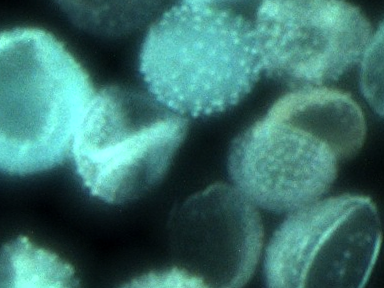
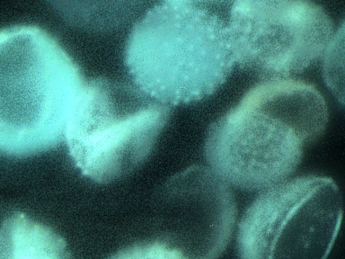

# 实拍花粉景深融合对照

2026 年 11 月 26 日抽取 8 个采集日期的 10 个视野，共 296 张 4096 × 3000 原图。各视野保留全部焦层，两套流程的输入顺序和 SHA-256 一致。

**Helicon B 在本批样本的颗粒边缘、表面细纹和暗背景表现上总体占优。**

| 测量 | Helicon Focus 8.1.0 B | focus-stack 1.5 |
| --- | ---: | ---: |
| 单视野 CPU 耗时中位数 | 3.25 s | 17.50 s |
| 含花粉局部的背景噪声估计中位数 | 0.66 灰度级 | 1.99 灰度级 |

18 个含花粉局部中，focus-stack 有 17 个的背景噪声估计升高。两个补测视野在同样的降噪设置下关闭配准后，弧形亮点拖影明显减轻。近空白对照的中心窗口则是 Helicon 留下的细亮线更多。

## 11 月 11 日的密集花粉视野

| 原始焦层 Z=+14 | Helicon B | focus-stack 默认 |
| --- | --- | --- |
|  |  |  |

## 报告与运行证据

在本地打开 report.html 可查看逐视野整图预览、384 × 288 原生像素局部、补测与日志。仓库版保留输出的尺寸、格式与 SHA-256，全分辨率成片保存在实验机的实验目录。 [离线报告](report.html) · [指标 CSV](comparison.csv) · [逐视野测量与成片哈希](analysis.json) · [输入索引](inputs/dataset.json)

Helicon 按旧日志的半径 8、平滑 4 和相同输入顺序复跑。早期复跑的 .bmp 文件经文件头检查实际是 JPEG，正式对照重新生成并逐张验证了无压缩 TIFF。focus-stack 采用固定发行版、FS_Default、8 线程和批次 8，输出 PNG。 [旧参数与格式核验](prior_helicon_settings.json)
