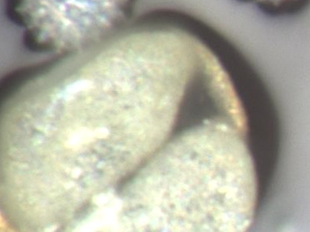
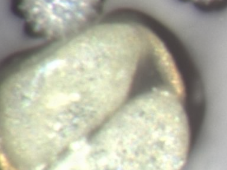

# 新打光花粉景深融合对照

明场邻域版和 Helicon B 在 40 个视野、1,979 张原图上完成了同焦栈对照。16 个留出视野中，明场邻域版有 14 个的外壁结构相关更高，16 个的低结构背景残差均更低。Helicon 在 14 个可配对小颗粒窗口里仍保有更强的细节对比，明场邻域版整体画质尚未超过 Helicon B。

## 29 层短栈的外壁剖面

| Helicon B | PollenEDF-Adaptive | 明场邻域版 |
| --- | --- | --- |
|  |  |  |

明场邻域版将旧 Adaptive 的双暗谷减为一个，与 Helicon B 的暗谷位置相近。收紧最高两级频带的焦层权重后，12 个开发裁片的细节幅度均提高，同时低结构像素的残差升高。 [原始焦层与融合剖面](case-measurements/rim-profiles.png) · [细频带裁片测量](detail-crop-trial/measurements.json)

离线报告包含 40 个视野的同视野裁片、焦点曲线、指标和运行摘要。代表性执行日志内的本机路径已作替换。完整原始焦栈与全分辨率成片保存在实验机。 [离线报告](report.html) · [研发记录与复跑方法](../../new-lighting-edf.md) · [留出测量](holdout-lighting-metrics.csv) · [输入与成片审计](audit.json)
