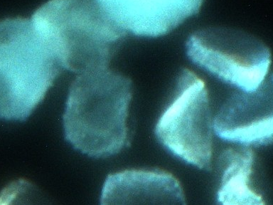
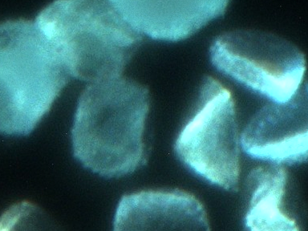
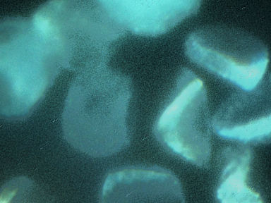
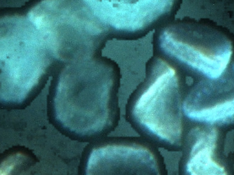

# PollenEDF V0.2 实拍验证

5 个开发视野和 4 个日期留出视野共使用 266 张原片。182 次运行包含全视野对照与真实裁片诊断。冻结的 PollenEDF-Adaptive 在留出暗区的高通 RMS 中位数为 0.386，Helicon B 为 0.706，官方 focus-stack 1.5 为 1.303。自研在暗背景和内存占用上取得改善，颗粒外壁、间隙和低对比结构的整体质量仍低于 Helicon B。

## 留出视野中的环状外壁

| 同视野参考原片 | Helicon B | 官方 focus-stack | PollenEDF-Adaptive |
| --- | --- | --- | --- |
|  |  |  |  |

仓库报告包含同区域裁片、焦点曲线、焦层图、置信度图、失效分析和测量表。运行摘要保留实际参数、输入顺序和哈希、成片哈希、耗时与资源计量。代表性执行日志内的本机路径已作替换。完整原片及全分辨率结果保存在实验机。 [离线报告](report.html) · [研发记录](../../pollen-edf-v02-results.md) · [输入与成片审计](holdout-checks.json) · [留出测量](holdout-measurements.csv)
